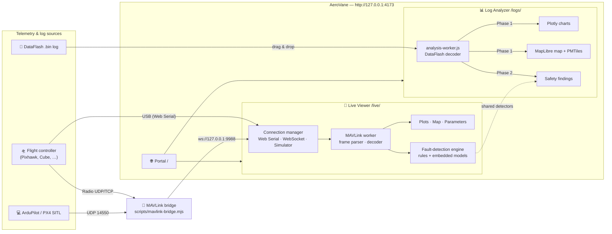

<div align="center">

# 🛸 AeroVane

### Real-time drone telemetry and post-flight log analysis — entirely in your browser

**Monitor live MAVLink telemetry, analyze 500 MB+ ArduPilot DataFlash logs, and get advisory fault warnings — with no cloud uploads, no accounts, and no install beyond Node.js.**

[](https://github.com/MdAzullah/AeroVane/actions/workflows/ci.yml)
[](https://nodejs.org/)
[](https://www.typescriptlang.org/)
[](https://www.solidjs.com/)
[](https://vitejs.dev/)
[](https://mavlink.io/)
[](docs/USER_GUIDE.md)

[Quick start](#-quick-start) · [Features](#-features) · [Architecture](#-architecture) · [User guide](docs/USER_GUIDE.md) · [Contributing](CONTRIBUTING.md)

</div>

---

## 📌 What is AeroVane?

AeroVane is a local-first flight operations suite for drones and robotic vehicles running **ArduPilot** or **PX4**. It bundles three browser apps behind a single local address — **http://127.0.0.1:4173** — so pilots, engineers, and researchers can:

| | Tool | Use it to… |
|:--:|---|---|
| 📡 | **Live Viewer** (`/live/`) | Connect to a vehicle over USB or the network, plot telemetry at 60 FPS, manage parameters, and see live safety advisories. |
| 📊 | **Saved Log Analyzer** (`/logs/`) | Drop in a `.bin` DataFlash log, explore every signal on synchronized charts, replay the flight path on a map, and review automated safety findings. |
| 🌉 | **MAVLink Bridge** (`npm run bridge`) | Route MAVLink between telemetry radios, SITL, Mission Planner/QGroundControl, and the browser over UDP, TCP, or WebSocket. |

### Why AeroVane?

| Common pain point | AeroVane's approach |
|---|---|
| Logs uploaded to third-party clouds | **Everything runs on your machine.** The server binds to `127.0.0.1` only; logs and telemetry never leave the computer. |
| Browser tabs freeze on large logs | **Two-phase, off-thread parsing.** Charts and map appear within seconds; deep safety analysis continues in a Web Worker. |
| Heavy desktop GCS installs | **Just Node.js and a browser.** Works on Windows, macOS, and Linux. |
| No connectivity in the field | **Offline-ready.** The Live Viewer is an installable PWA; the Log Analyzer supports offline `.pmtiles` basemaps. |
| Manually hunting for faults | **Built-in detectors.** Rule-based detectors plus small embedded models flag battery, GPS, EKF, vibration, motor, and link issues as *advisories*. |

---

## ✨ Features

<details open>
<summary><b>📡 Live Telemetry Viewer</b> — <code>apps/live-viewer</code> (SolidJS + TypeScript)</summary>

- **Direct USB** via the Web Serial API (incl. FTDI adapters) in Chrome, Edge, and Brave — no bridge needed.
- **Network telemetry** over WebSocket from the bundled bridge (UDP/TCP radios, SITL, companion computers).
- **Built-in simulator** (Settings → simulation scenarios, environments, and flight profiles) with spoofed telemetry, parameters, and fault scenarios for demos and testing without hardware.
- **High-speed plotting** with [uPlot](https://github.com/leeoniya/uPlot): synchronized crosshairs, zoom, and draggable grid layouts.
- **Parameter manager**: read, search, group, and edit autopilot parameters, with metadata downloaded over MAVLink FTP.
- **Dynamic dialects**: MAVLink XML dialects are loaded at runtime — no hard-coded message IDs.
- **Live map** (Leaflet): position, heading, and trajectory.
- **AI Safety panel**: 13 fault detectors — 11 rule-based (battery, GPS, EKF, attitude, altitude loss, vibration, motor imbalance, temperature, comms loss, sensor staleness, status text) plus two embedded ML models — with optional audible critical alerts.
- **TLOG recording and replay**, message monitor, debug console, and a log library.
- **Installable PWA** that keeps working offline.

</details>

<details open>
<summary><b>📊 Saved Log Analyzer</b> — <code>apps/saved-log-viewer</code> (JavaScript + Web Workers)</summary>

- **Two-phase pipeline** for large ArduPilot DataFlash (`.bin`) logs:
  1. **Phase 1 – instant view.** The worker decodes the log and unlocks charts, signal explorer, and map within seconds.
  2. **Phase 2 – background safety analysis.** Deep diagnostics run off the main thread behind a sticky progress banner (*Running safety analysis… X%*), which you can skip at any time.
- **Synchronized multi-axis charts** ([Plotly.js](https://plotly.com/javascript/)) for attitude, altitude, battery, vibration, motor outputs, and any custom signal.
- **WebGL flight map** ([MapLibre GL](https://maplibre.org/)) with street, terrain, dark, and satellite layers plus **offline [PMTiles](https://protomaps.com/docs/pmtiles) basemaps** for air-gapped use.
- **Flight overview**: duration, distance, altitude delta, and velocity statistics.
- **Safety findings** reuse the Live Viewer's fault-detection engine, so live and post-flight results stay consistent.

</details>

<details open>
<summary><b>🌉 MAVLink Bridge</b> — <code>scripts/mavlink-bridge.mjs</code> (zero-dependency Node.js)</summary>

- Routes raw MAVLink bytes between any number of endpoints: `udpserver`, `udpclient`, `tcpserver`, `tcpclient`, `wsserver`, and `fakesource` (test telemetry).
- Lets Mission Planner / QGroundControl and AeroVane share one telemetry link.
- An optional legacy Linux x86-64 binary with extra serial/REST features lives in [`bridge/`](bridge/README.md).

</details>

---

## 🏗️ Architecture



**How the pieces fit:** `npm run build` compiles the Live Viewer (Vite), bundles the Log Analyzer's AI and map runtimes (esbuild), and assembles everything into `dist/`. `npm start` serves `dist/` from a small, dependency-free Node.js server bound to loopback only.

---

## 🚀 Quick start

### Prerequisites

| Requirement | Version | Notes |
|---|---|---|
| [Node.js](https://nodejs.org/) | **22** (see `.nvmrc`) | `nvm use` picks the right version |
| npm | 10+ | ships with Node.js |
| Browser | Chrome, Edge, or Brave | needed for USB / Web Serial; any modern browser works for logs and WebSocket |

### Install, build, run

```bash
git clone https://github.com/MdAzullah/AeroVane.git
cd AeroVane

npm ci                              # root tooling (map runtime)
npm --prefix apps/live-viewer ci    # Live Viewer dependencies
npm run build                       # build everything into dist/

npm start                           # serves http://127.0.0.1:4173 and opens your browser
```

| Page | URL |
|---|---|
| Portal | http://127.0.0.1:4173/ |
| Live Viewer | http://127.0.0.1:4173/live/ |
| Saved Log Analyzer | http://127.0.0.1:4173/logs/ |

Keep the terminal open while you use AeroVane; press `Ctrl+C` to stop.

> **Linux (optional):** `npm run install:local` installs a per-user systemd service and a desktop shortcut so AeroVane starts automatically.

---

## 🧭 Common workflows

<details>
<summary><b>Analyze a flight log</b></summary>

1. Open http://127.0.0.1:4173/logs/.
2. Drag your `.bin` file onto the drop zone (a `sample_flight.bin` is included in `apps/saved-log-viewer/`).
3. Explore charts and the flight path as soon as they appear; safety findings fill in as the background analysis finishes.

</details>

<details>
<summary><b>Monitor a drone over USB</b></summary>

1. Connect the flight controller to your computer by USB.
2. Open http://127.0.0.1:4173/live/ in Chrome, Edge, or Brave.
3. Click **Connect Serial** and choose the port.

</details>

<details>
<summary><b>Fly ArduPilot SITL</b></summary>

```bash
sim_vehicle.py -v ArduCopter --console --map                         # terminal 1
npm run bridge -- udpserver://0.0.0.0:14550 wsserver://127.0.0.1:9988  # terminal 2
```

Then open the Live Viewer and click **Connect WS**.

</details>

<details>
<summary><b>Try it with no hardware</b></summary>

```bash
npm run dev:bridge    # fake telemetry on ws://127.0.0.1:9988
```

Or pick a simulation scenario in the Live Viewer's **Settings**.

</details>

Mission Planner sharing, telemetry antennas, offline maps, and troubleshooting are covered in the **[User Guide](docs/USER_GUIDE.md)**.

---

## 🛠️ Development

| Command | What it does |
|---|---|
| `npm run dev` | Live Viewer dev server with hot reload (http://localhost:5173) |
| `npm run dev:saved` | Serve the Log Analyzer source on http://127.0.0.1:8080 |
| `npm run dev:bridge` | Bridge with fake telemetry on `ws://127.0.0.1:9988` |
| `npm run build` | Full production build into `dist/` |
| `npm run typecheck` | TypeScript type-check (Live Viewer) |
| `npm test` | Log Analyzer + Live Viewer unit tests |
| `npm run verify` | Type-check, build, and test everything — **run before every PR** |
| `npm --prefix apps/live-viewer run e2e` | Playwright end-to-end tests |

### Test suites

| Suite | Runner | Location | Size |
|---|---|---|---|
| Live Viewer unit & component | Vitest + happy-dom | `apps/live-viewer/src/**/__tests__` | 68 files · ~600 tests |
| Live Viewer end-to-end | Playwright (Chromium) | `apps/live-viewer/e2e` | 4 specs |
| Log Analyzer | `node --test` | `apps/saved-log-viewer/tests` | 17 tests |
| ML pipeline | pytest | `ml/` | ~90 tests |

CI ([`.github/workflows/ci.yml`](.github/workflows/ci.yml)) runs `npm run verify` and the Playwright suite on every push and pull request to `main`.

See **[CONTRIBUTING.md](CONTRIBUTING.md)** for setup details, coding conventions, and the PR checklist.

---

## 📂 Repository layout

```text
AeroVane/
├── apps/
│   ├── portal/               # Landing page served at /
│   ├── live-viewer/          # 📡 Real-time MAVLink viewer (SolidJS, Vite, PWA)
│   │   ├── src/mavlink/      #    Frame parser/builder, decoder, dialect registry
│   │   ├── src/services/     #    Serial/WebSocket/simulator sources, params, FTP, TLOG
│   │   ├── src/workers/      #    Off-main-thread MAVLink pipeline
│   │   ├── src/analysis/     #    Fault engine, detectors, embedded models
│   │   ├── src/components/   #    UI: plots, map, parameters, AI safety panel
│   │   ├── src/store/        #    Application state
│   │   └── e2e/              #    Playwright tests
│   └── saved-log-viewer/     # 📊 DataFlash log analyzer (GPL-3.0, see Licensing)
│       ├── dataflash.js      #    .bin decoder
│       ├── analysis-worker.js#    Two-phase background parser
│       ├── main.js           #    App shell, charts, safety banner
│       ├── map-gl.js         #    MapLibre map + PMTiles
│       ├── ai-entry.ts       #    → ai-analysis.js (esbuild, reuses live-viewer engine)
│       ├── map-entry.ts      #    → map-runtime.js (esbuild)
│       └── tests/
├── scripts/                  # 🌉 Bridge, local server, build & install scripts
├── bridge/                   #    Optional legacy Linux bridge binary
├── ml/                       # 🧠 Governed ML pipeline: ingestion, training, export
├── docs/USER_GUIDE.md        # 📖 End-user guide
├── .github/                  #    CI, issue & PR templates
├── data/  models/  dist/     #    Local-only (git-ignored)
└── ATTRIBUTION.md            #    Third-party notices
```

---

## 🧠 About the AI safety features

AeroVane's fault detection is **advisory only**. It never commands the vehicle, changes parameters, or triggers failsafes.

- **Rule-based detectors** check thresholds and trends (battery sag, GPS fix/HDOP, EKF variances, vibration, motor imbalance, link loss, and more).
- **Two embedded models** run in the browser through a portable, schema-validated format (`apps/live-viewer/src/analysis/models/`):
  - `aerovane-basic-sensor-1.0.0`: a small dense network **trained on simulated data**.
  - `aerovane-real-anomaly-2.0.0`: a decision tree trained and evaluated on the reviewed UAV-SEAD flight dataset (see `ml/experiments/`).
- The [`ml/`](ml/README.md) workspace documents data governance, licence audits, training preflight checks, and evaluation reports.

Treat every warning as a prompt to inspect the vehicle, not as a diagnosis.

---

## ⚠️ Safety notice

AeroVane is a monitoring and analysis tool, **not** a ground control station. Keep your primary GCS (Mission Planner, QGroundControl) in control of the aircraft, test new setups with the vehicle safely on the ground, and never edit parameters from two applications at once.

---

## 📄 Licensing

AeroVane is a multi-licence repository:

| Component | Licence |
|---|---|
| Repository default, including `apps/live-viewer`, `apps/portal`, `scripts/`, `ml/` | [MIT](LICENSE) |
| `apps/saved-log-viewer` (derived from SearchWing *swlogview*) | [GPL-3.0-or-later](apps/saved-log-viewer/copyright.txt) |

Builds that include the Log Analyzer (`dist/`) therefore contain GPL-licensed code. Upstream projects, libraries, and datasets are credited in **[ATTRIBUTION.md](ATTRIBUTION.md)**.

---

## 👤 Author

**MD Azizullah** · [@MdAzullah](https://github.com/MdAzullah) · md.azizullah.engineer@gmail.com

Bug reports and feature requests are welcome via [GitHub Issues](https://github.com/MdAzullah/AeroVane/issues). If AeroVane helps you, consider giving the repo a ⭐.
